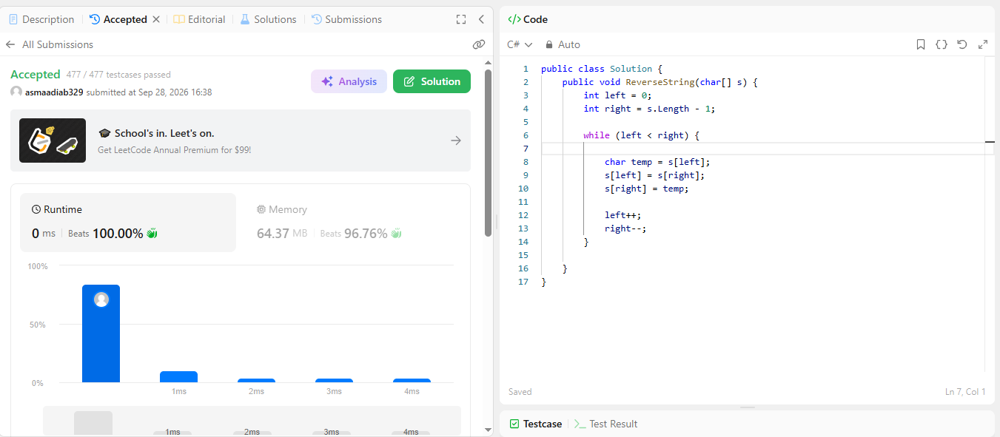

# Reverse String Solution

## Solution Idea
Using the **Two Pointers** approach:
1. Place `left` pointer at the start (index `0`) and `right` pointer at the end (`s.Length - 1`).
2. Swap characters at `left` and `right`.
3. Move `left` forward (`left++`) and `right` backward (`right--`).
4. Repeat until `left >= right`.

## Complexity
- **Time Complexity:** $O(n)$
- **Space Complexity:** $O(1)$

## Screenshot
